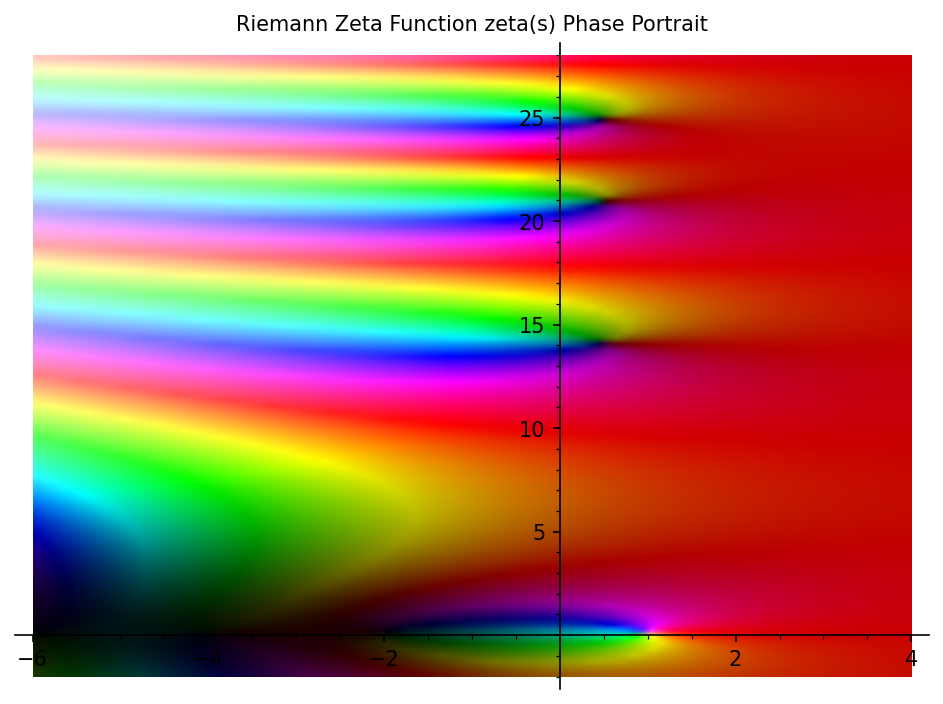
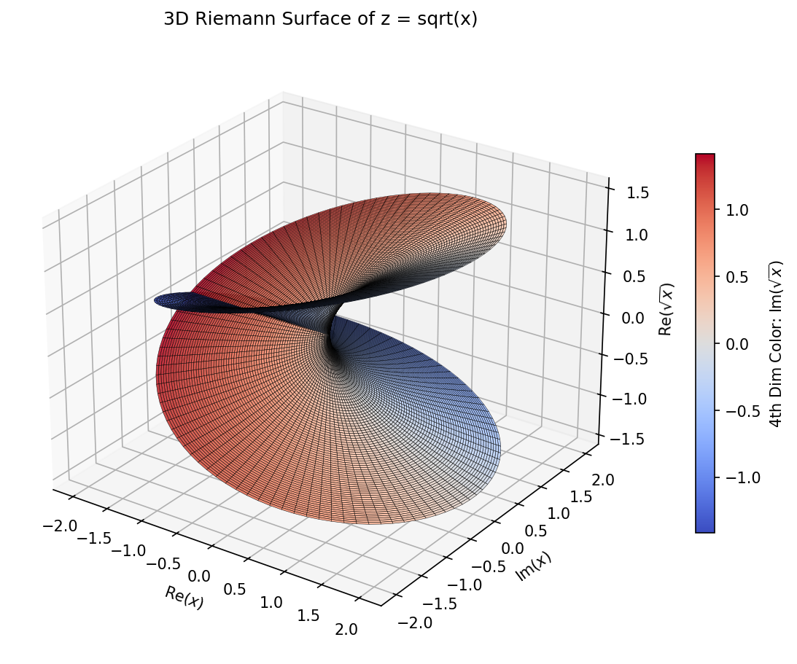
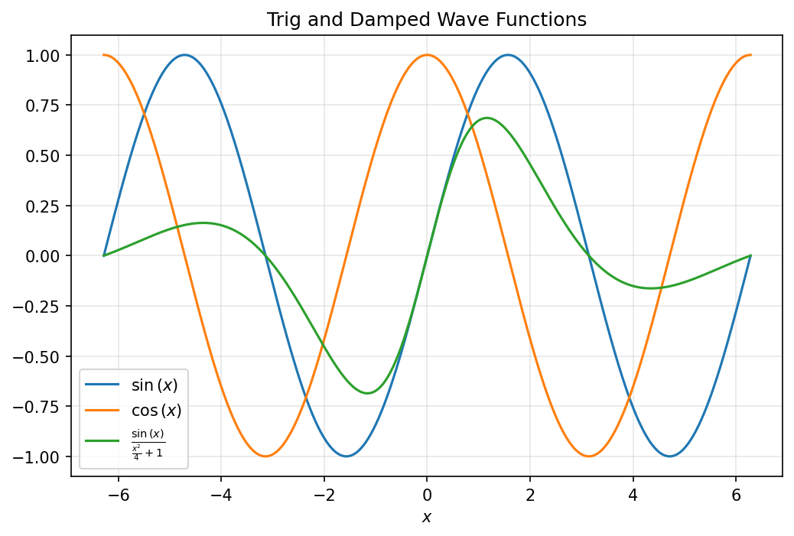
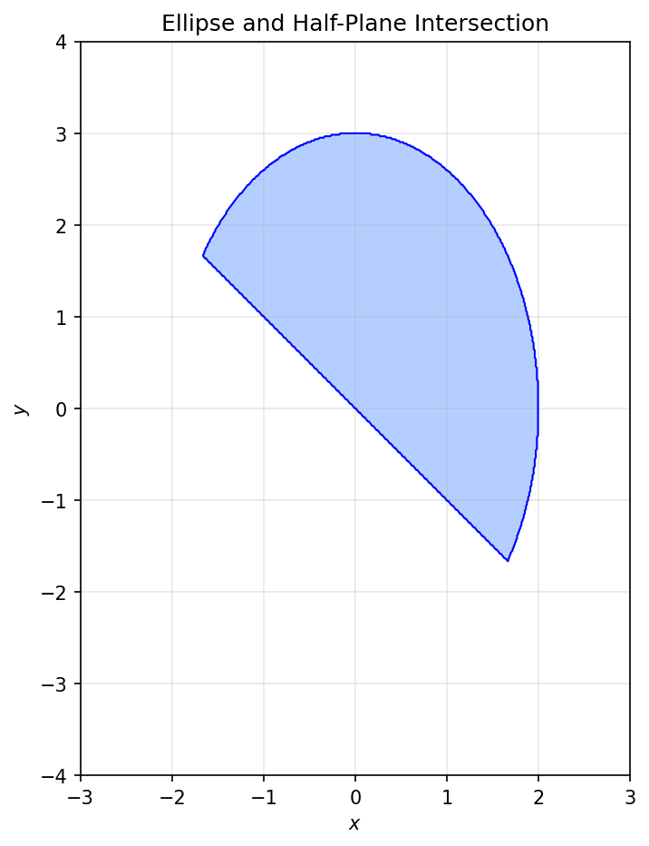
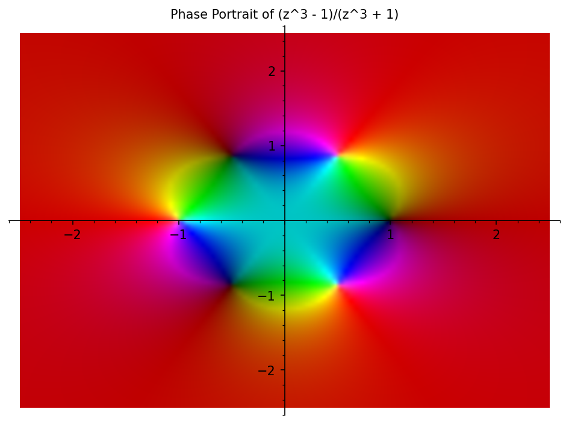

# AI4Math 综合案例展示（计算 · Riemann Zeta · 证明 · 黎曼面与可视化）

本文档由 [`examples/run_demo.py`](run_demo.py) 调用 AI4Math 内置的 **SymPy + SageMath + Matplotlib** 工具引擎自动生成。

---

## 案例一：精确符号计算（Computation）

- **无穷级数精确求和**（`compute_sum`）：计算 $\sum_{n=1}^{\infty} \frac{1}{n^4}$

  $$\frac{\pi^{4}}{90}$$

- **多项式 $x^4 - 2$ 在 $\mathbb{Q}$ 上的 Galois 群**（`galois_group`）：

  $$\operatorname{Gal}(f) \cong \text{D(4)} \quad (|G| = 8)$$
  结构描述：`D4`，是否交换群：`False`。

- **离散分布高阶矩方差**（`compute_variance`）：设 $X \sim \mathrm{Binomial}(10, 0.3)$，精确有理数计算 $\mathrm{Var}[X^2]$

  $$\frac{46977}{500}$$

- **Poisson 分布矩母函数闭式解**（`moment_generating_function`）：设 $X \sim \mathrm{Poisson}(\lambda)$

  $$M_X(t) = e^{- \lambda \left(1 - e^{t}\right)}$$

---

## 案例二：Riemann Zeta 函数专题（解析数论计算 + 零极点可视化）

1. **特殊点精确符号值**（Euler 偶数值与解析延拓负整数值）：
   $$\zeta(2) = \frac{\pi^{2}}{6},\qquad \zeta(6) = \frac{\pi^{6}}{945},\qquad \zeta(0) = - \frac{1}{2},\qquad \zeta(-1) = - \frac{1}{12},\qquad \zeta(-2) = 0$$

2. **Riemann 函数方程与临界线非平凡零点检验**（`sage_eval`）：
   检验函数方程 $\zeta(s) = 2^s \pi^{s-1} \sin\!\left(\frac{\pi s}{2}\right) \Gamma(1-s)\zeta(1-s)$ 及临界线 $\operatorname{Re}(s) = \frac{1}{2}$ 上的前三个非平凡零点 $\frac{1}{2} + i\gamma_k$：
   > `fe_error=2.48e-16, zeros=[14.134725, 21.02204, 25.010858], |zeta(1/2+i*gamma_1)|=6.67e-16`

3. **Riemann Zeta 复平面可视化**：
   复平面区域 $\operatorname{Re}(s) \in [-6, 4],\; \operatorname{Im}(s) \in [-2, 28]$ 上的色相图（`sage_complex_plot`）：
图中可同时观察到 $s = 1$ 处的简单极点、负偶整数 $s = -2, -4, -6$ 处的平凡零点，以及临界线 $\operatorname{Re}(s) = \frac{1}{2}$ 上依次排列的非平凡零点 $\frac{1}{2} + i\gamma_k$。

   

---

## 案例三：简单数学证明（Simple Proof）

**命题：** 对任意素数 $p \ge 5$，均有 $24 \mid (p^2 - 1)$。

### 1. 小范围计算检验（`verify_conjecture`）
- 检验区间与结果：`共测试 93 个值: 93 通过, 0 失败`（对 $5 \le p < 500$ 的全部素数无一反例）。

### 2. 代数证明骨架验证（`construct_proof`）
  - ✓ 检验模 3 剩余类：与 3 互素的整数平方模 3 恒为 1: [1, 1]
  - ✓ 检验模 8 剩余类：所有奇数平方模 8 恒为 1: [1, 1, 1, 1]
  - ✓ 验证 gcd(3, 8) = 1，由中国剩余定理合并同余式得模 24 余 0: True

### 3. 完整严格证明
1. **模 $3$ 分析：** 因为 $p \ge 5$ 是素数，故 $3 \nmid p$，从而 $p \equiv 1$ 或 $2 \pmod{3}$。无论何种情形，均有
   $$p^2 \equiv 1 \pmod{3} \implies 3 \mid (p^2 - 1).$$
2. **模 $8$ 分析：** 因为 $p \ge 5$ 是奇素数，故 $p \equiv 1, 3, 5, 7 \pmod{8}$。由有限环 $(\mathbb{Z}/8\mathbb{Z})^\times$ 中每个元素的阶均整除 $2$，得
   $$p^2 \equiv 1 \pmod{8} \implies 8 \mid (p^2 - 1).$$
3. **合并结论：** 由于 $\gcd(3, 8) = 1$，根据中国剩余定理（或整除的最小公倍数性质 $\operatorname{lcm}(3, 8) = 24$），立得
   $$24 \mid (p^2 - 1). \qquad \square$$

---

## 案例四：三维黎曼面与多维可视化（Visualization）

### 1. 三维四维着色黎曼面 $z = \sqrt{x}$（`plot_riemann_surface`）
采用极坐标双叶单值化 $x = r e^{i\theta}\;(\theta \in [0, 4\pi])$：以高度轴表示 $\operatorname{Re}(\sqrt{x})$，以曲面冷暖色标映射第四维 $\operatorname{Im}(\sqrt{x})$。可以看到绕支点 $x = 0$ 旋转一周平滑换叶，且负实轴处虽然两叶高度均为 $\operatorname{Re}(\sqrt{x}) = 0$，但一暖（$+\sqrt{r}$）一冷（$-\sqrt{r}$）直观表明两叶在 $\mathbb{C}^2 \cong \mathbb{R}^4$ 中并不相交：

### 2. 多函数对比曲线（`plot_function`，支持符号区间 `[-2*pi, 2*pi]`）
绘制 $\sin(x)$、$\cos(x)$ 与阻尼振荡函数 $\frac{\sin(x)}{1 + x^2/4}$：

### 3. 不等式交集区域填充（`plot_inequality_region`）
绘制椭圆内部与半平面的交集 $\frac{x^2}{4} + \frac{y^2}{9} < 1 \;\land\; x + y > 0$：

### 4. 单值复变函数色相图
复变函数 $f(z) = \frac{z^3 - 1}{z^3 + 1}$ 的色相图（`sage_complex_plot`，零点与极点呈对称三叶分布）：

